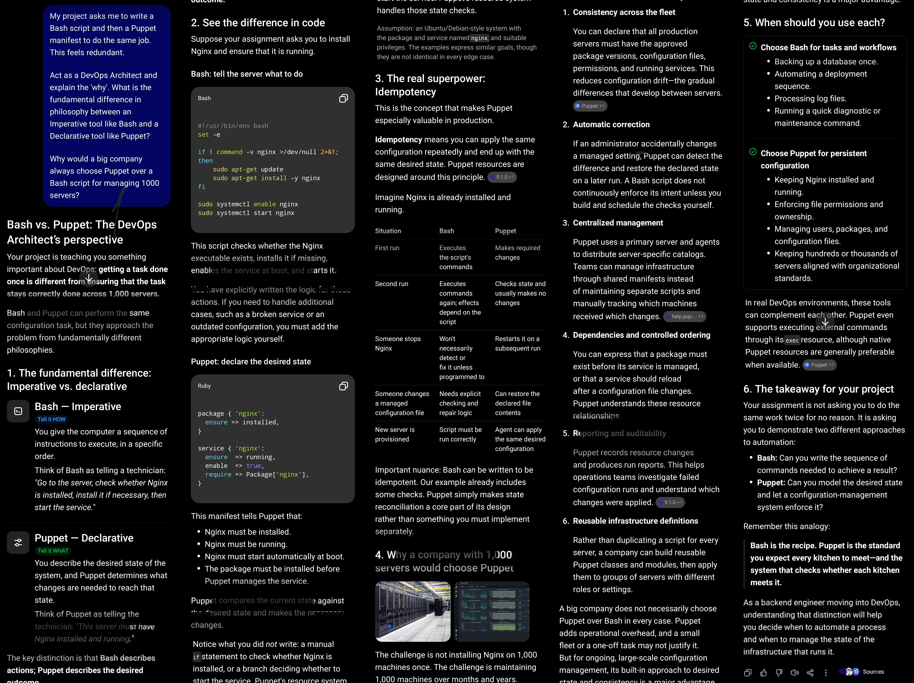

# AI: DevOps Philosophy and Tool Interrogation

## Objective
Use AI as a DevOps Architect to explain the philosophical difference between Imperative (Bash) and Declarative (Puppet) tools, then reflect on Idempotence and scalability across 1000 servers.

## Prompt Used
```
My project asks me to write a Bash script and then a Puppet manifest to do the same job. This feels redundant.

Act as a DevOps Architect and explain the 'why'. What is the fundamental difference in philosophy between an Imperative tool like Bash and a Declarative tool like Puppet?

Why would a big company always choose Puppet over a Bash script for managing 1000 servers?
```

## Files
- `analysis.txt`: the AI's complete Imperative vs. Declarative explanation
- `screenshot.jpg`: screenshot of the AI's complete response
- `README.md`: this documentation and my reflection

## Evidence of Interaction (Screenshot)
The AI's complete comparative explanation (read the columns left to right, top to bottom):



## Key Takeaways
- Imperative (Bash) describes HOW: an ordered list of commands with no built-in awareness of the server's current state.
- Declarative (Puppet) describes WHAT: the desired end state, and the tool works out the minimal steps to reach it.
- Puppet is idempotent, corrects configuration drift, and scales to 1000 servers from one source of truth.
- Bash can be written to be idempotent, but the engineer must build every check by hand; Puppet makes state reconciliation part of its design.

## Reflection
Idempotence means that applying the same configuration any number of times leaves the system in the same final state as applying it once. In configuration management this is what makes a tool safe to run continuously. Puppet achieves it by inspecting each resource before acting: if the package is already installed, the file already matches, and the service is already running, it does nothing; if one has changed, it fixes only that. A Bash script that blindly appends a line to a config file or recreates a user will duplicate entries or fail on the second run, so engineers must wrap every command in custom existence checks, which is exactly the logic a declarative tool provides by design.

This is the single most critical factor at scale because configuration drift is inevitable. Across 1000 servers, manual hot-fixes, partial updates and failed runs mean no two machines stay identical for long. Idempotence lets the agent re-apply the full desired state on every cycle with no risk: compliant nodes are untouched, drifted nodes are converged back to the baseline, and nodes that missed a previous run simply catch up. Without it, re-running automation is dangerous, so teams stop running it, and drift accumulates unseen until it causes an outage or a security gap. Idempotence turns the desired state into a guarantee that is continuously enforced rather than a hope.
